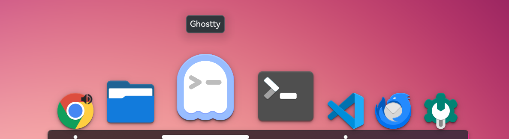

#  Latte Dock NG

> **Fork notice**: This is an unofficial fork of [KDE Latte Dock](https://github.com/KDE/latte-dock) maintained by Ruizhi Zhong, targeting **KDE Plasma 6.3+ on Wayland only**. Development happens on Plasma 6.5+ / Qt 6.11; Plasma 6.3 (Debian 13 trixie) is verified as the minimum supported version. X11 support has been intentionally removed.

Latte Dock NG is a Wayland-first dock for KDE Plasma 6.3+ that provides an elegant and intuitive experience for your tasks and widgets. It animates its contents using a parabolic zoom effect and stays out of the way when not needed.

**"Art in Coffee"**

Screenshots
===========

Classic dock style:



Modern dock style:


Development
============

- This fork: https://github.com/ruizhi-lab/latte-dock-ng
- Release notes: `CHANGELOG.md`
- Upstream KDE repo: https://invent.kde.org/plasma/latte-dock
- GitHub mirror of upstream: https://github.com/KDE/latte-dock
- Bug reports for this fork: https://github.com/ruizhi-lab/latte-dock-ng/issues
- Bug reports for upstream: https://bugs.kde.org/enter_bug.cgi?product=lattedock


Installation
============

### Requirements

Runtime requirements:

- **Plasma >= 6.3.0** (developed and fully verified on Plasma 6.5+)
- **Qt >= 6.7**
- **KCMUtils, Kirigami and NewStuff QML modules**
- **Wayland session (X11 is not supported in this fork)**

Source build requirements:

**Build tools:**
```
 bash, git, cmake >= 3.20, extra-cmake-modules, make or Ninja,
 pkg-config, gettext, and a C++20-capable compiler (GCC 10+ / Clang 12+)
```

**development packages for:**
```
 Qt6Core >= 6.7.0
 Qt6Gui >= 6.7.0
 Qt6DBus >= 6.7.0
 Qt6Qml >= 6.7.0
 Qt6Quick >= 6.7.0
 Qt6Widgets >= 6.7.0
 Qt6WaylandClient >= 6.7.0

 Plasma >= 6.3.0
 PlasmaQuick >= 6.3.0
 PlasmaActivities >= 6.3.0
 KWayland >= 6.3.0
 PlasmaActivitiesStats >= 6.3.0
 LibTaskManager >= 6.3.0

 KF6Config >= 6.10.0
 KF6CoreAddons >= 6.10.0
 KF6GuiAddons >= 6.10.0
 KF6DBusAddons >= 6.10.0
 KF6Declarative >= 6.10.0
 KF6Package >= 6.10.0
 KF6XmlGui >= 6.10.0
 KF6IconThemes >= 6.10.0
 KF6KIO >= 6.10.0
 KF6I18n >= 6.10.0
 KF6Notifications >= 6.10.0
 KF6NewStuff >= 6.10.0
 KF6Archive >= 6.10.0
 KF6GlobalAccel >= 6.10.0
 KF6Crash >= 6.10.0
 KF6WindowSystem >= 6.10.0
 KF6Svg >= 6.10.0

 PlasmaWaylandProtocols >= 1.6
 Wayland::Client
 LayerShellQt >= 6.3.0
```

### Repository installation (recommended)

Repositories provide package-manager upgrades and resolve dependencies automatically:

- **Fedora 44:** [Fedora COPR](https://copr.fedorainfracloud.org/coprs/ruizhi-lab/latte-dock-ng/).
- **Debian 13 / testing and Ubuntu 26.04:** [signed APT repository](https://ruizhi-lab.github.io/latte-dock-ng/).
- **Gentoo:** [ruizhi-overlay](https://github.com/ruizhi-lab/gentoo-overlay).
- **openSUSE Tumbleweed / Mageia Cauldron:** distribution-specific repositories on the COPR project page.
- **NixOS:** the project's flake and NixOS module.

See [`INSTALLATION.md`](INSTALLATION.md) for setup and upgrade commands.

### Binary packages (GitHub Releases)

Download packages for your distribution from
[GitHub Releases](https://github.com/ruizhi-lab/latte-dock-ng/releases):

- **Debian 13:** `latte-dock-ng_<ver>-1+deb13u1_amd64.deb`.
- **Debian testing:** `latte-dock-ng_<ver>-1_amd64.deb`.
- **Ubuntu 26.04:** `latte-dock-ng_<ver>-1ubuntu1_amd64.deb`.
- **Fedora / openSUSE Tumbleweed / Mageia Cauldron:** use the RPM named for your distribution.
- **Arch Linux:** `pkg.tar.zst`.

Debian 13 ships `libPlasma.so.6`, Debian testing and Ubuntu ship `.so.7`, and
Plasma 6.8 (Fedora 44, openSUSE Tumbleweed, Arch) ships `.so.8`. Select packages
for your target distribution rather than mixing these ABI versions, and see
[Upgrading Plasma across a libplasma soname
bump](INSTALLATION.md#upgrading-plasma-across-a-libplasma-soname-bump) when a
Plasma upgrade reports a missing `libPlasma.so.N` dependency.
All release packages target amd64/x86_64. NixOS uses the flake instead of a
standalone release package. openSUSE Leap with Plasma 5 is unsupported.

### Building from source

See [`INSTALLATION.md`](INSTALLATION.md) for distribution-specific build
packages and installation commands. Repository and release-package installs
do not require development packages.

Maintainer release procedures are in
[`docs/release-workflow.md`](docs/release-workflow.md).

## Run Latte Dock NG

Latte Dock NG is now ready to be used by executing
```
latte-dock-ng
```

or activating **Latte Dock NG** from the applications menu.


Contributors
============
- [Ruizhi Zhong](https://github.com/ruizhi-lab): Maintainer of this fork (Plasma 6.5+ / Wayland).
- [Varlesh](https://github.com/varlesh): Logos and Icons.
- Original Latte Dock authors and contributors: thank you for the upstream foundation.


License & Copyright
===================

**Current fork (Latte Dock NG):**
Copyright (C) 2024-2026 Ruizhi Zhong
Author & Contact: Ruizhi Zhong <ruizhi.zhong88@gmail.com>
Licensed under GNU General Public License 3.0 (GPL-3.0).

This project is based on the original Latte Dock by KDE contributors.
Special thanks to all original Latte Dock authors and contributors.

This program is free software: you can redistribute it and/or modify it under the terms of the GNU General Public License as published by the Free Software Foundation, either version 3 of the License, or (at your option) any later version.

This program is distributed in the hope that it will be useful, but WITHOUT ANY WARRANTY; without even the implied warranty of MERCHANTABILITY or FITNESS FOR A PARTICULAR PURPOSE. See the GNU General Public License for more details.

The full text of the GPL-3.0 license is available at: https://www.gnu.org/licenses/gpl-3.0.html
